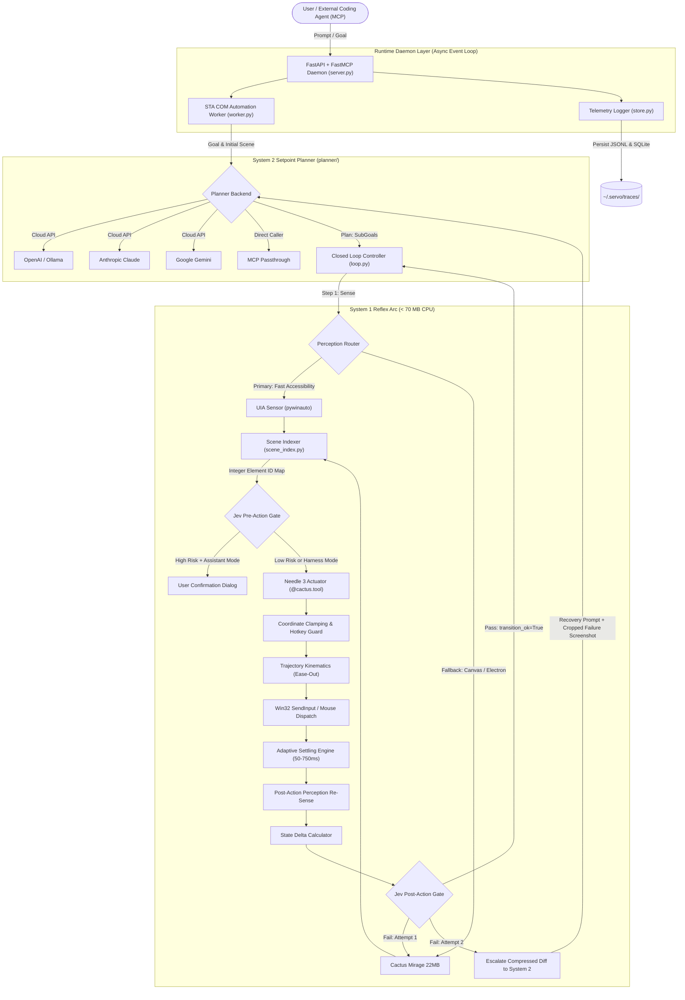
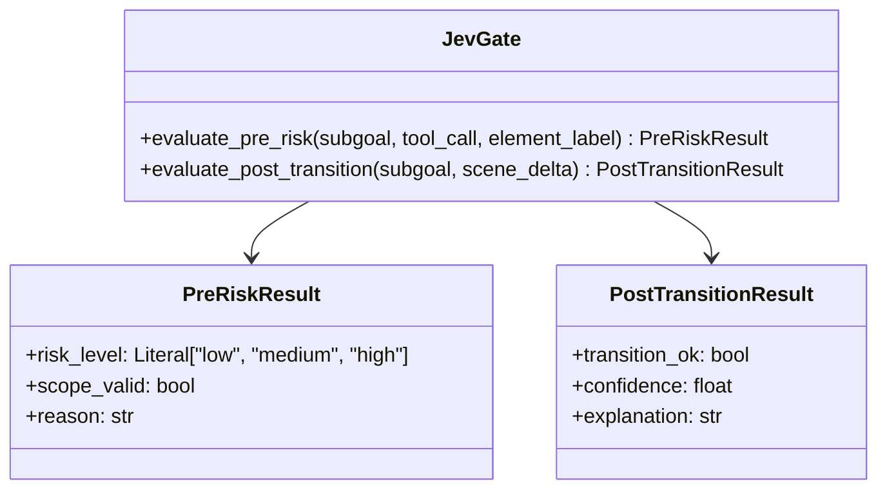
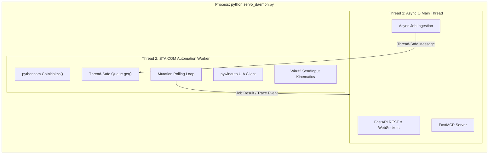

# SERVO V1 — System Architecture & Architectural Decision Records (ADR)

**Document Identifier:** `SERVO-ARCH-V1-FROZEN`  
**Version:** `1.0.0`  
**Status:** `FROZEN / IMMUTABLE`  
**Target Platform:** Windows 10 / Windows 11 (UIA + Win32)  
**Parent Framework:** Noesis Frameworks  
**Author:** Servo Core Engineering Team  
**Date of Ratification:** November 20, 2026  

---

> [!IMPORTANT]
> **IMMUTABILITY CHARTER:**  
> This document is the definitive, immutable architectural baseline for Servo v1. **It will never be edited or mutated.** If real-world implementation discoveries, API evolutions, or platform shifts require design changes, this file remains untouched as an audit trail, and a new document (`SERVO_ARCHITECTURE_V2.md`) will be created to supersede it.

---

## Table of Contents

1. [Executive Summary & High-Level Mission](#1-executive-summary--high-level-mission)
2. [The Core Metaphor: The Three-Tier Servomechanism](#2-the-core-metaphor-the-three-tier-servomechanism)
3. [End-to-End System Topology](#3-end-to-end-system-topology)
4. [Architectural Decision Records (ADRs) — The What and Why](#4-architectural-decision-records-adrs--the-what-and-why)
   * [ADR-01: Hybrid Perception Strategy (UIA-First, Mirage Fallback)](#adr-01-hybrid-perception-strategy-uia-first-mirage-fallback)
   * [ADR-02: Unified Integer Scene Index (Zero Raw Coordinates to Needle 3)](#adr-02-unified-integer-scene-index-zero-raw-coordinates-to-needle-3)
   * [ADR-03: Sub-70 MB System 1 Budget on CPU](#adr-03-sub-70-mb-system-1-budget-on-cpu)
   * [ADR-04: Non-Autoregressive Jev/Kev Safety Gate via System One HTTP API](#adr-04-non-autoregressive-jevkev-safety-gate-via-system-one-http-api)
   * [ADR-05: Dedicated STA COM Worker Thread for Win32/UIA Isolation](#adr-05-dedicated-sta-com-worker-thread-for-win32uia-isolation)
   * [ADR-06: Windows Per-Monitor DPI v2 Coordinate Normalization](#adr-06-windows-per-monitor-dpi-v2-coordinate-normalization)
   * [ADR-07: Full Physical Input Sandboxing & Corner-Slam Failsafe](#adr-07-full-physical-input-sandboxing--corner-slam-failsafe)
   * [ADR-08: Adaptive Settling Time & Mutation Debounce Engine](#adr-08-adaptive-settling-time--mutation-debounce-engine)
   * [ADR-09: Two-Step Local Recovery Ladder Before System 2 Escalation](#adr-09-two-step-local-recovery-ladder-before-system-2-escalation)
   * [ADR-10: Multi-Provider System 2 Registry with MCP Passthrough](#adr-10-multi-provider-system-2-registry-with-mcp-passthrough)
   * [ADR-11: Dual Telemetry Storage (Fast JSONL + Queryable SQLite)](#adr-11-dual-telemetry-storage-fast-jsonl--queryable-sqlite)
   * [ADR-12: Single-Process Daemon Exposing FastAPI and FastMCP](#adr-12-single-process-daemon-exposing-fastapi-and-fastmcp)
5. [Subsystem Deep Dives & Data Contracts](#5-subsystem-deep-dives--data-contracts)
   * [5.1 Perception Subsystem (`perception/`)](#51-perception-subsystem-perception)
   * [5.2 Actuation & Kinematics Subsystem (`actuation/`)](#52-actuation--kinematics-subsystem-actuation)
   * [5.3 Control & Safety Subsystem (`control/`)](#53-control--safety-subsystem-control)
   * [5.4 Planning Subsystem (`planner/`)](#54-planning-subsystem-planner)
   * [5.5 Daemon & Concurrency Subsystem (`daemon/`)](#55-daemon--concurrency-subsystem-daemon)
   * [5.6 Telemetry & Tracing Subsystem (`telemetry/`)](#56-telemetry--tracing-subsystem-telemetry)
6. [Lifecycle & Sequence Workflows](#6-lifecycle--sequence-workflows)
7. [Repository File Map](#7-repository-file-map)
8. [Edge Cases & Defensive Playbook](#8-edge-cases--defensive-playbook)

---

## 1. Executive Summary & High-Level Mission

Current desktop agent systems suffer from a severe architectural flaw: **brute-force visual open-loop execution**. They capture high-resolution screenshots at every step, pass megabytes of images to a distant, multi-billion-parameter Vision-Language Model (VLM) over the internet, wait several seconds for text generation, guess pixel coordinates, click blindly, and repeat without verifying what changed. This results in:
* **Prohibitive Latency:** 2 to 6 seconds per atomic click.
* **Massive Compute & Financial Cost:** Hundreds of thousands of visual tokens consumed for simple desktop interactions.
* **High Failure Rates:** Spatial hallucinations, missing click targets on high-DPI screens, and inability to detect whether an action actually succeeded.

**Servo's Mission:**  
Build a **local-first, closed-loop, neuro-symbolic desktop control runtime** for Windows 10 and 11 that operates like a biological reflex arc. Macro intelligence plans the setpoint, while micro intelligence executes and validates physical actions locally, under 100 milliseconds, on CPU, within a 70 MB footprint.

---

## 2. The Core Metaphor: The Three-Tier Servomechanism

Servo is designed after classical control theory (cybernetics). In a physical servomechanism (e.g., a cruise-control system or robotic arm), high-level goals are transformed into physical reality through continuous sensing, comparison, and actuation.

```mermaid
flowchart TD
    subgraph Classical["Classical Mechanical Servomechanism"]
        direction LR
        SP["Setpoint Goal"] --> Comp["Comparator"]
        Comp -->|Error Signal| Act["Actuator (Motor)"]
        Act --> Plant["Physical World"]
        Plant --> Sens["Sensor (Encoder)"]
        Sens -->|Feedback| Comp
    end

    subgraph ServoMapping["Servo Neuro-Symbolic Mapping"]
        direction LR
        S2["System 2 (Planner Backend)"] --> Jev["Jev Safety Gate (Comparator)"]
        Jev -->|Approved Action| Needle["Needle 3 (Actuator)"]
        Needle --> WinOS["Windows UI (Physical OS)"]
        WinOS --> Sense["UIA + Mirage (Sensor)"]
        Sense -->|Scene Delta| Jev
    end
```



### The Three Tiers:
1. **Tier 1: Reference Setpoint (System 2 — High-Level Reasoning):**
   * Uses an LLM (Claude, GPT, Gemini, or local Ollama) or an external driving agent (via MCP).
   * Decomposes the user's high-level intent ("Submit the quarterly report in accounting software") into bounded, discrete sub-goals.
   * **Crucial Rule:** System 2 never sees raw desktop screenshots during normal execution and never handles pixel coordinates. It steps out of the loop while the reflex arc runs.
2. **Tier 2: The Comparator & Safety Gate (`control/`):**
   * Powered by **Jev** (implemented via `jaredpalmer/kev` decision models).
   * Performs non-autoregressive classification: evaluates pre-action safety risk (`low | medium | high`) and validates post-action state transitions (`transition_ok: bool`).
3. **Tier 3: The Sensor & Actuator Reflex Arc (`perception/` & `actuation/`):**
   * **Sensor:** Fast Windows UI Automation (`pywinauto` UIA) query, falling back to **Cactus Mirage (22 MB)** on canvas/unlabeled controls.
   * **Actuator:** **Cactus Needle 3** invokes typed `@cactus.tool` actions using stable integer element IDs, driving human-like cubic ease-out mouse trajectories and synthetic keyboard inputs.

---

## 3. End-to-End System Topology



---

## 4. Architectural Decision Records (ADRs) — The What and Why

### ADR-01: Hybrid Perception Strategy (UIA-First, Mirage Fallback)
* **Status:** `ACCEPTED / FROZEN`
* **What:** The perception engine queries the Windows UI Automation (UIA) tree first. It only invokes the visual model (Cactus Mirage 22 MB) if UIA returns fewer than 3 interactive controls or if an action fails post-verification.
* **Why:**
  * **Speed:** UIA extraction takes 5–25 milliseconds, compared to 150–400 milliseconds for image capture and vision inference.
  * **Compute Budget:** UIA consumes 0 MB of VRAM and near-zero CPU cycles.
  * **Reliability:** UIA provides exact semantic strings (e.g., `Save`, `Search settings`) directly from the OS accessibility tree, eliminating OCR errors on small system fonts.
  * **Fallback Necessity:** Certain apps (e.g., Discord, custom Electron interfaces, Canvas games, or Figma) render controls onto a flat pixel surface where UIA is blind. Mirage handles these seamlessly.

---

### ADR-02: Unified Integer Scene Index (Zero Raw Coordinates to Needle 3)
* **Status:** `ACCEPTED / FROZEN`
* **What:** The perception layer assigns a deterministic, sequential integer (`0, 1, 2, ...`) to every interactive element found in the window. Needle 3 tools only accept `element_id: int`.
* **Why:**
  * **Eliminates Spatial Hallucination:** Small neural models frequently hallucinate or skew floating-point coordinates (e.g., clicking `x=452, y=891` instead of `x=430, y=860`).
  * **Stable Interface:** Actuation code computes the exact mathematical pixel center `((left + right) // 2, (top + bottom) // 2)` deterministically in Python. The model only decides *what* to click, never *where* the pixels are.
  * **Source Agnostic:** Needle 3 executes identically whether an element was discovered via UIA or Mirage.

---

### ADR-03: Sub-70 MB System 1 Budget on CPU
* **Status:** `ACCEPTED / FROZEN`
* **What:** The core reflex arc (Mirage 22 MB + Needle 3 8–29 MB + Jev Gate) is constrained to under 70 MB of RAM and defaults strictly to CPU execution with physical core threading.
* **Why:**
  * **Zero VRAM Footprint:** Desktop developers and CI machines frequently run memory-heavy workloads, games, or local 70B LLMs. Servo must never compete for GPU VRAM.
  * **Instant Startup:** Sub-50MB model weights load from disk into memory in under 80 milliseconds.
  * **Universal Compatibility:** Runs reliably on office laptops, cloud virtual machines, and development desktops without dedicated graphics cards.

---

### ADR-04: Non-Autoregressive Jev/Kev Safety Gate via System One HTTP API
* **Status:** `ACCEPTED / FROZEN`
* **What:** Safety evaluation and state-transition verification are performed by non-autoregressive decision models (`jaredpalmer/kev`) via the standard `POST /v1/systemone` HTTP protocol, with an integrated rule-based heuristic fallback for offline operation.
* **Why:**
  * **No Text Generation:** Standard LLMs waste hundreds of milliseconds generating conversational fluff before outputting a JSON boolean. Decision models output calibrated probability distributions over options in a single forward pass without generating text.
  * **Process Isolation:** Hosting the decision model as an external or sidecar HTTP service prevents loading PyTorch model weights into Servo's core daemon, preserving the `< 70 MB` memory ceiling.
  * **Offline Resilience:** The heuristic fallback ensures unit tests and local CLI smoke tests function seamlessly without spinning up a model server.

---

### ADR-05: Dedicated STA COM Worker Thread for Win32/UIA Isolation
* **Status:** `ACCEPTED / FROZEN`
* **What:** All Windows UI Automation queries and Win32 input syntheses run inside a dedicated long-running background worker thread initialized with Single-Threaded Apartment COM (`pythoncom.CoInitialize()`). Communication with the FastAPI/FastMCP daemon occurs via thread-safe queues.
* **Why:**
  * **Event Loop Protection:** `pywinauto` makes synchronous cross-process RPC calls into target applications. If a target application hangs or is unresponsive, UIA can block for seconds. If this occurred on the asyncio main thread, the MCP server and WebSocket telemetry would freeze.
  * **COM Thread Affinity:** Windows COM interfaces require strict thread initialization. Calling COM methods across uninitialized or arbitrary thread-pool threads leads to `RPC_E_WRONG_THREAD` exceptions.

---

### ADR-06: Windows Per-Monitor DPI v2 Coordinate Normalization
* **Status:** `ACCEPTED / FROZEN`
* **What:** On startup, Servo invokes `SetProcessDpiAwarenessContext(DPI_AWARENESS_CONTEXT_PER_MONITOR_AWARE_V2)`. All bounding boxes are transformed through a `ViewportTransform` mapping normalized `0–1000` coordinates to physical screen pixels.
* **Why:**
  * **Eliminates Coordinate Drift:** Modern Windows laptops use 125%, 150%, or 200% display scaling. Without DPI v2 awareness, Windows virtualizes the process coordinates, causing synthetic mouse clicks to land dozens of pixels away from visual buttons.
  * **Window-Relative Scoping:** Normalizing coordinates relative to the target window's client rectangle guarantees that UI capture remains precise even if the window is moved across monitors with different DPI factors.

---

### ADR-07: Full Physical Input Sandboxing & Corner-Slam Failsafe
* **Status:** `ACCEPTED / FROZEN`
* **What:** Physical inputs are constrained by:
  1. Clamping all mouse clicks strictly within the target `HWND` client rectangle.
  2. Blocking destructive hotkeys (`Alt+F4`, `Win+L`, `Alt+Tab`, `Ctrl+Alt+Del`).
  3. Halting execution immediately if the mouse cursor hits the top-left corner `(0, 0)` (corner-slam failsafe) or if the `Esc` break key is pressed.
* **Why:**
  * **Prevents CI Escapes:** In `harness` mode, an agent clicking outside the target application could close the terminal, delete files, or interact with sensitive host windows.
  * **Human Operator Safety:** In `assistant` mode, the operator must have an infallible physical reflex to take back control without hunting for a software stop button.

---

### ADR-08: Adaptive Settling Time & Mutation Debounce Engine
* **Status:** `ACCEPTED / FROZEN`
* **What:** After an action is performed, the control loop waits a 100 ms base delay, then polls the window state for up to 750 ms until an accessibility or visual mutation occurs before calling the post-action verification gate.
* **Why:**
  * **Eliminates False Negatives:** Desktop and web UIs do not re-render instantaneously. Button click animations, network requests, and DOM mutations take 50–400 ms. Sampling at 0 ms reads stale pre-action state, causing the verification gate to declare a false failure.
  * **Avoids Static Delays:** Using a fixed 1-second delay after every step would needlessly slow down execution. Bounded polling continues as soon as a change is observed.

---

### ADR-09: Two-Step Local Recovery Ladder Before System 2 Escalation
* **Status:** `ACCEPTED / FROZEN`
* **What:** If an action fails post-verification, Servo executes a strict 2-step recovery sequence:
  * **Attempt 1:** Standard UIA pass $\rightarrow$ Needle tool execution.
  * **Attempt 2:** Force a full visual pass via Cactus Mirage (22 MB) $\rightarrow$ Rebuild Scene Index $\rightarrow$ Retry Needle tool.
  * **Escalation:** If Attempt 2 fails, package a compressed state diff and cropped failure screenshot, then hand off to System 2.
* **Why:**
  * **Cost Optimization:** Over 80% of transient UI automation errors (e.g., dynamic popups, focus drops, or custom-rendered buttons) can be resolved locally by taking a fresh visual pass.
  * **Protects System 2 Context:** Avoids sending routine execution noise and large images to the cloud LLM, reserving expensive tokens exclusively for high-level plan recovery.

---

### ADR-10: Multi-Provider System 2 Registry with MCP Passthrough
* **Status:** `ACCEPTED / FROZEN`
* **What:** The planner module implements an extensible `PlannerBackend` protocol supporting OpenAI-compatible APIs (OpenAI, Ollama, vLLM), Anthropic Claude, and Google Gemini native SDKs, along with a zero-overhead MCP Passthrough mode.
* **Why:**
  * **Portability:** Developers can run Servo fully offline with local Ollama, in production with Claude or Gemini, or controlled directly by external coding agents over the Model Context Protocol (MCP).
  * **Pluggable Protocol:** Adding a new provider requires implementing only two methods: `decompose()` and `recover()`.

---

### ADR-11: Dual Telemetry Storage (Fast JSONL + Queryable SQLite)
* **Status:** `ACCEPTED / FROZEN`
* **What:** Every execution trace is recorded to `~/.servo/traces/` in two formats simultaneously: an append-only JSONL stream (`traces.jsonl`) for high-speed streaming and crash resilience, and a local SQLite database (`traces.sqlite`) for relational querying.
* **Why:**
  * **Zero Latency Overhead:** JSONL writes are append-only and take less than 1 millisecond.
  * **Rich Inspections:** SQLite enables instant filtering of test runs by success rate, latency, fallback frequency, and error codes without parsing gigabytes of raw logs.

---

### ADR-12: Single-Process Daemon Exposing FastAPI and FastMCP
* **Status:** `ACCEPTED / FROZEN`
* **What:** Servo runs as a unified local daemon combining a standard FastAPI REST/WebSocket server and a FastMCP server over a single process footprint.
* **Why:**
  * **Dual Interface:** External coding agents connect natively via MCP (`run_task`, `assert_ui_state`), while local web dashboards and system tray indicators connect via REST/WebSockets.
  * **Low Overhead:** Avoids managing multiple background processes, ports, or inter-process socket synchronizations.

---

## 5. Subsystem Deep Dives & Data Contracts

### 5.1 Perception Subsystem (`perception/`)

#### Coordinate Normalization Math
Windows screen coordinates $(X_{screen}, Y_{screen})$ are mapped to a normalized $1000 \times 1000$ grid relative to the window client rect:

$$\text{Norm}_X = \left\lfloor \frac{X_{screen} - X_{win\_origin}}{W_{win}} \times 1000 \right\rfloor$$

$$\text{Norm}_Y = \left\lfloor \frac{Y_{screen} - Y_{win\_origin}}{H_{win}} \times 1000 \right\rfloor$$

#### Unified Scene Index Schema (`scene_index.json`)
```json
{
  "hwnd": 198432,
  "window_title": "Notepad - Untitled",
  "source": "uia",
  "timestamp": 1732115740.125,
  "viewport": {
    "x": 100,
    "y": 150,
    "width": 1024,
    "height": 768,
    "dpi_scale": 1.25
  },
  "elements": {
    "0": {
      "element_id": 0,
      "label": "Text editor",
      "role": "Edit",
      "bbox_screen": [108, 201, 1116, 880],
      "bbox_norm": [8, 51, 992, 951],
      "center_screen": [612, 540],
      "is_keyboard_focusable": true
    },
    "1": {
      "element_id": 1,
      "label": "File",
      "role": "MenuItem",
      "bbox_screen": [108, 175, 148, 195],
      "bbox_norm": [8, 25, 47, 45],
      "center_screen": [128, 185],
      "is_keyboard_focusable": false
    }
  }
}
```

#### Structured Scene Delta Schema (`SceneDelta`)
```json
{
  "has_changed": true,
  "title_changed": false,
  "old_title": "Notepad - Untitled",
  "new_title": "Notepad - Untitled",
  "added_labels": ["Save changes dialog", "Save", "Don't Save", "Cancel"],
  "removed_labels": [],
  "value_changes": {
    "Text editor": {
      "old_value": "",
      "new_value": "Hello world"
    }
  }
}
```

---

### 5.2 Actuation & Kinematics Subsystem (`actuation/`)

#### Needle 3 Tool Interface (`@cactus.tool`)
Needle 3 interacts exclusively through typed Python tool signatures:

```python
@cactus.tool
def click(element_id: int, button: Literal["left", "right", "double"] = "left") -> str:
    """Click on the target element using its integer ID."""

@cactus.tool
def type_text(element_id: int, text: str, press_enter: bool = False, clear_first: bool = False) -> str:
    """Focus target element and enter text."""

@cactus.tool
def hotkey(keys: list[str]) -> str:
    """Send a validated sequence of key combinations."""

@cactus.tool
def scroll(direction: Literal["up", "down"], amount: int = 3) -> str:
    """Scroll the active window viewport."""

@cactus.tool
def drag(source_id: int, target_id: int) -> str:
    """Drag from source element center to target element center."""

@cactus.tool
def wait(seconds: float) -> str:
    """Pause execution for a specified duration."""
```

#### Trajectory Kinematics Formula
When `fast_mode=False`, the mouse moves along a smooth cubic ease-out trajectory over $N$ steps ($N \in [10, 40]$ depending on Euclidean distance $D$):

$$P(t) = P_{start} + (P_{target} - P_{start}) \cdot \left[1 - (1 - t)^3\right], \quad t \in [0, 1]$$

Each step is punctuated by high-resolution timer delays (`time.perf_counter()`), providing human-like kinematics that prevent anti-bot detection in target applications.

---

### 5.3 Control & Safety Subsystem (`control/`)

#### Jev Gate Contract (`POST /v1/systemone`)



---

### 5.4 Planning Subsystem (`planner/`)

#### Protocol Definition
```python
from typing import Protocol
from pydantic import BaseModel

class SubGoal(BaseModel):
    step_index: int
    instruction: str
    target_element_hint: str | None = None
    expected_outcome: str

class EscalationContext(BaseModel):
    failed_subgoal: SubGoal
    attempt_count: int
    last_tool_call: str
    scene_delta: dict
    cropped_screenshot_b64: str | None

class PlannerBackend(Protocol):
    def decompose(self, goal: str, initial_scene: dict) -> list[SubGoal]:
        """Decompose a high-level goal into ordered sub-goals."""
        ...

    def recover(self, context: EscalationContext) -> list[SubGoal]:
        """Generate replacement sub-goals following execution failure."""
        ...
```

---

### 5.5 Daemon & Concurrency Subsystem (`daemon/`)

#### Threading Topology



---

### 5.6 Telemetry & Tracing Subsystem (`telemetry/`)

#### Relational SQLite Schema (`traces.sqlite`)
```sql
CREATE TABLE IF NOT EXISTS runs (
    run_id TEXT PRIMARY KEY,
    timestamp DATETIME DEFAULT CURRENT_TIMESTAMP,
    mode TEXT NOT NULL,
    status TEXT NOT NULL,
    goal TEXT NOT NULL,
    total_latency_ms INTEGER,
    uia_steps INTEGER,
    mirage_fallbacks INTEGER,
    system2_escalations INTEGER
);

CREATE TABLE IF NOT EXISTS steps (
    step_id INTEGER PRIMARY KEY AUTOINCREMENT,
    run_id TEXT NOT NULL,
    step_index INTEGER NOT NULL,
    sub_goal TEXT NOT NULL,
    perception_source TEXT NOT NULL,
    tool_call TEXT NOT NULL,
    jev_pre_risk TEXT NOT NULL,
    jev_post_ok BOOLEAN NOT NULL,
    latency_ms INTEGER NOT NULL,
    FOREIGN KEY(run_id) REFERENCES runs(run_id)
);
```

---

## 6. Lifecycle & Sequence Workflows

The complete lifecycle of a single sub-goal execution through the closed-loop reflex arc:

```mermaid
sequenceDiagram
    autonumber
    participant S2 as System 2 (Planner)
    participant Loop as Servo Control Loop
    participant Sense as Perception (UIA/Mirage)
    participant Jev as Jev Gate (Kev)
    participant Act as Actuator (Needle 3)
    participant OS as Windows UI

    S2->>Loop: Dispatch SubGoal("Click File menu")
    Loop->>Sense: Sense Target HWND
    Sense-->>Loop: SceneIndex (0: "File", 1: "Edit")
    
    Loop->>Jev: Pre-Action Check(SubGoal, "click(0)", "File")
    Jev-->>Loop: {risk: "low", scope_valid: true}
    
    Loop->>Act: Execute click(element_id=0)
    Act->>OS: Cubic Ease-Out Cursor Move + Left Click
    
    Loop->>OS: Adaptive Settling (Wait 100ms + Poll Mutation)
    OS-->>Loop: Settled
    
    Loop->>Sense: Post-Action Re-Sense
    Sense-->>Loop: Updated SceneIndex
    Loop->>Loop: Calculate SceneDelta
    
    Loop->>Jev: Post-Action Check(SubGoal, SceneDelta)
    alt Transition Succeeded
        Jev-->>Loop: {transition_ok: true}
        Loop-->>S2: Step Passed
    else Transition Failed (Attempt 1)
        Jev-->>Loop: {transition_ok: false}
        Loop->>Sense: Force Mirage Visual Pass (Attempt 2)
        Sense-->>Loop: Visual SceneIndex
        Loop->>Act: Retry Needle Tool Call
        Act->>OS: Secondary Click
        Loop->>Jev: Post-Action Re-Check
        alt Visual Retry Succeeded
            Jev-->>Loop: {transition_ok: true}
            Loop-->>S2: Step Passed via Visual Fallback
        else Visual Retry Failed (Attempt 2)
            Jev-->>Loop: {transition_ok: false}
            Loop-->>S2: Escalate with Compressed State Diff & Screenshot
        end
    end
```

---

## 7. Repository File Map

```text
c:\Projects\servo\
├── pyproject.toml                 # Package configuration, dependencies & entrypoints
├── README.md                      # Developer onboarding and quickstart guide
├── SERVO_ARCHITECTURE_V1.md       # [THIS FILE] Immutable Architecture & ADR Specification
│
├── servo/
│   ├── __init__.py                # Package export
│   ├── config.py                  # Pydantic Settings, DPI v2 awareness boot, hardware probe
│   │
│   ├── perception/
│   │   ├── __init__.py
│   │   ├── viewport.py            # DPI v2 transforms, HWND bounding math, normalized 0-1000 grid
│   │   ├── uia_sensor.py          # pywinauto UIA accessibility tree extractor
│   │   ├── mirage_sensor.py       # Cactus Mirage (22 MB) wrapper with mock fallback
│   │   ├── scene_index.py         # Integer element_id indexing and structured delta engine
│   │   └── watchdog.py            # Win32 SetWinEventHook focus and creation listener
│   │
│   ├── actuation/
│   │   ├── __init__.py
│   │   ├── trajectory.py          # Cubic ease-out kinematics, corner-slam failsafe, fast_mode
│   │   ├── needle_tools.py        # @cactus.tool bindings (click, type_text, hotkey, scroll, drag)
│   │   └── sandboxing.py          # Coordinate clamping to HWND & destructive hotkey blacklist
│   │
│   ├── control/
│   │   ├── __init__.py
│   │   ├── jev_gate.py            # /v1/systemone HTTP client + heuristic rule fallback
│   │   ├── settling.py            # Adaptive UI settling & mutation debounce poller
│   │   └── loop.py                # Closed-loop state machine & 2-step recovery ladder
│   │
│   ├── planner/
│   │   ├── __init__.py
│   │   ├── base.py                # PlannerBackend protocol & SubGoal data models
│   │   ├── openai_compat.py       # OpenAI & local Ollama client adapter
│   │   ├── anthropic_adapter.py   # Anthropic Claude client adapter
│   │   ├── gemini_adapter.py      # Google Gemini client adapter
│   │   └── passthrough.py         # Direct MCP caller passthrough adapter
│   │
│   ├── telemetry/
│   │   ├── __init__.py
│   │   ├── models.py              # Structured Trace Payload Pydantic models
│   │   └── store.py               # SQLite + JSONL rolling trace logger
│   │
│   └── daemon/
│       ├── __init__.py
│       ├── worker.py              # Dedicated STA COM automation worker thread & task queue
│       ├── server.py              # FastAPI + FastMCP server exposing run_task, assert_ui_state
│       └── ui.py                  # System tray icon & PyWebView HUD overlay
│
└── tests/
    ├── __init__.py
    ├── fixtures/
    │   └── test_fixture.html      # Local HTML test harness (inputs, canvas, custom buttons)
    ├── test_viewport.py           # Unit tests for DPI transforms & coordinate clamping
    ├── test_scene_index.py        # Unit tests for element ID mapping & state diffing
    ├── test_sandboxing.py         # Unit tests for hotkey blocking & coordinate bounds
    ├── test_settling.py           # Unit tests for debounce & mutation detection
    └── test_notepad_loop.py       # Deterministic end-to-end smoke test on Notepad & HTML fixture
```

---

## 8. Edge Cases & Defensive Playbook

| Scenario | Root Cause | Built-In Defense Mechanism |
| :--- | :--- | :--- |
| **High-DPI Display Drift** | Windows virtualizes process coordinates on 125%/150% scaled screens. | `SetProcessDpiAwarenessContext` called on boot; `ViewportTransform` reads true physical pixels from `GetWindowRect`. |
| **Unresponsive UI Thread** | Target application freezes during heavy compute, blocking UIA COM calls. | UIA calls run inside `worker.py` on a separate thread with a strict 2000 ms timeout; daemon never hangs. |
| **UAC / Elevated Window** | Target window is elevated (Admin), blocking lower-integrity synthetic inputs. | `config.py` probes user token integrity; inputs failing with `ERROR_ACCESS_DENIED` trigger clean escalation rather than an infinite retry loop. |
| **Delayed Render / Animation** | Web or WinUI elements take 200 ms to mount after a button click. | `settling.py` polls for mutation up to 750 ms before calling Jev, preventing false-negative post-action failures. |
| **Cursor Escapes Target Window** | Miscalculated drag or click lands on an external window. | `sandboxing.py` clamps all coordinates to the active `HWND` boundary before dispatching `SendInput`. |
| **Operator Panic / Runaway Loop** | Automation executes undesired actions in `assistant` mode. | Slashing the cursor to corner `(0, 0)` or pressing `Esc` immediately aborts the worker thread. |
| **Canvas / Unlabeled Controls** | Application (e.g. Electron, Canvas) does not publish accessibility nodes. | UIA sensor detects $< 3$ interactive controls and triggers an automatic Cactus Mirage visual pass. |

---

**END OF DOCUMENT — FROZEN AT VERSION 1.0.0**