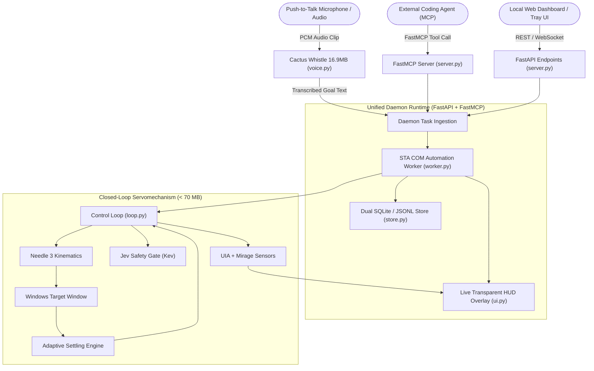

# SERVO V2 — System Architecture & Architectural Decision Records (ADR)

**Document Identifier:** `SERVO-ARCH-V2-FROZEN`  
**Version:** `2.0.0`  
**Status:** `FROZEN / IMMUTABLE`  
**Target Platform:** Windows 10 / Windows 11 (UIA + Win32 + FastMCP)  
**Parent Framework:** Noesis Frameworks  
**Author:** Servo Core Engineering Team  
**Date of Ratification:** November 20, 2026  
**Predecessor Document:** [`SERVO_ARCHITECTURE_V1.md`](file:///C:/Projects/servo/SERVO_ARCHITECTURE_V1.md)

---

> [!IMPORTANT]
> **IMMUTABILITY CHARTER:**  
> This document supersedes `SERVO_ARCHITECTURE_V1.md`. Per the Servo project governance rules, `SERVO_ARCHITECTURE_V1.md` remains completely untouched as a permanent audit trail. Any design evolutions, voice capabilities, and visual overlay mechanisms introduced in v2 are permanently codified in this document and will never be mutated. If v3 is required in the future, `SERVO_ARCHITECTURE_V3.md` will be created.

---

## 1. Executive Summary: What Changed in V2

Servo v2 builds upon the rock-solid v1 three-tier servomechanism (System 2 Planner, Jev Gate, System 1 Reflex Arc) by adding:
1. **Direct FastMCP Tool Integration:** External coding agents connect via native Model Context Protocol (`run_task_tool`, `assert_ui_state_tool`, `get_scene_index_tool`).
2. **Cactus Whistle (16.9 MB) Voice Pipeline:** Push-to-talk audio ingestion that transcribes user voice commands locally on CPU and dispatches them directly to the reflex arc without cloud STT.
3. **Live Transparent HUD Overlay:** Real-time visual grounding overlay that paints bounding boxes, integer element IDs, and active click targets directly onto the user's screen over target windows.

---

## 2. End-to-End System Topology (V2)



---

## 3. Architectural Decision Records (ADRs) — V2 Additions

### ADR-13: Cactus Whistle (16.9 MB) Voice Ingestion Pipeline
* **Status:** `ACCEPTED / FROZEN`
* **What:** Servo incorporates an audio ingestion pipeline (`servo/daemon/voice.py`) powered by Cactus Whistle (`cactus.transcribe`). In `assistant` mode, the operator can upload an audio buffer or trigger push-to-talk. The transcribed text is validated by the Jev pre-action risk gate and dispatched directly to the control loop.
* **Why:**
  * **Zero Cloud Latency:** Audio never leaves the local machine. Transcription completes locally in under 200 ms on CPU.
  * **Memory Footprint:** At only 16.9 MB, Whistle fits comfortably inside the low-memory budget.
  * **Hands-Free Automation:** Enables personal desktop commands (e.g. "close this window", "submit form", "open settings") via voice.

---

### ADR-14: Hardware-Accelerated Transparent HUD Overlay
* **Status:** `ACCEPTED / FROZEN`
* **What:** Servo includes a lightweight, transparent desktop overlay window (`servo/daemon/ui.py`) built using native Windows transparency and Tkinter. The HUD snaps to the target `HWND`'s client bounding box, rendering semi-transparent colored bounding boxes and integer `element_id` pills over detected controls in real time.
* **Why:**
  * **Visual Grounding:** Operators can physically see what Servo's perception layer detects, demystifying the agent's spatial understanding.
  * **Zero Click Interference:** The overlay uses `WS_EX_TRANSPARENT` / Win32 click-through styles so user and synthetic clicks pass straight through to the underlying application.
  * **Zero External Dependencies:** Uses Python's standard `tkinter` library, avoiding heavy external Chromium/CEF runtimes while operating within a 15 MB footprint.

---

### ADR-15: Dual-Surface FastMCP and REST Protocol
* **Status:** `ACCEPTED / FROZEN`
* **What:** The daemon exposes both standard HTTP/REST endpoints for web inspectors and a native FastMCP server with typed tools (`run_task_tool`, `assert_ui_state_tool`, `get_scene_index_tool`) over standard I/O (stdio) or SSE.
* **Why:**
  * **Agent Interoperability:** Coding agents (Antigravity, Claude Code, Cursor) can drive Servo directly as a standard MCP tool server without custom adapters.
  * **Backwards Compatibility:** REST endpoints (`/health`, `/scene`, `/task`, `/traces`) remain completely functional for existing CI scripts and webhooks.

---

## 4. Voice Ingestion Sequence Workflow

```mermaid
sequenceDiagram
    autonumber
    participant Op as User Operator
    participant Voice as Voice Ingestion (voice.py)
    participant Whistle as Cactus Whistle (16.9 MB)
    participant Worker as STA Automation Worker
    participant Loop as Servo Reflex Loop
    participant HUD as Transparent HUD Overlay

    Op->>Voice: Push-to-Talk Audio Stream (WAV / PCM)
    Voice->>Whistle: Transcribe Audio Clip
    Whistle-->>Voice: "Type Hello World into text editor"
    Voice->>Worker: Submit TaskJob(goal="Type Hello World into text editor")
    Worker->>Loop: Execute SubGoal
    Loop->>HUD: Render Active Target Bounding Box
    Loop->>Loop: Sense -> Gate -> Actuate -> Settle -> Verify
    Loop-->>Worker: Step Completed
    Worker-->>Voice: Execution Success
    Voice-->>Op: Notification / Audio Tone Confirmation
```

---

## 5. Repository File Map (V2)

```text
c:\Projects\servo\
├── pyproject.toml                 # Package configuration with fastmcp and cactus-compute extras
├── README.md                      # Developer onboarding and quickstart guide
├── SERVO_ARCHITECTURE_V1.md       # [V1 FROZEN AUDIT TRAIL]
├── SERVO_ARCHITECTURE_V2.md       # [THIS FILE - V2 FROZEN SPECIFICATION]
│
├── servo/
│   ├── __init__.py
│   ├── config.py                  # Settings, DPI awareness, hardware probe
│   ├── perception/
│   │   ├── viewport.py            # DPI v2 transforms, HWND bounding math, normalized grid
│   │   ├── uia_sensor.py          # pywinauto accessibility extractor
│   │   ├── mirage_sensor.py       # Cactus Mirage 22MB wrapper
│   │   ├── scene_index.py         # Integer element_id indexing and SceneDelta engine
│   │   └── watchdog.py            # Win32 focus listener
│   ├── actuation/
│   │   ├── trajectory.py          # Cubic ease-out kinematics & corner-slam failsafe
│   │   ├── needle_tools.py        # @cactus.tool bindings (click, type_text, hotkey, scroll, drag)
│   │   └── sandboxing.py          # Coordinate clamping & hotkey blacklist
│   ├── control/
│   │   ├── jev_gate.py            # /v1/systemone HTTP client + heuristic rule fallback
│   │   ├── settling.py            # Adaptive UI settling & mutation debounce poller
│   │   └── loop.py                # Closed-loop state machine & 2-step recovery ladder
│   ├── planner/
│   │   ├── base.py                # PlannerBackend protocol & SubGoal data models
│   │   ├── openai_compat.py       # OpenAI & local Ollama client adapter
│   │   ├── anthropic_adapter.py   # Anthropic Claude client adapter
│   │   ├── gemini_adapter.py      # Google Gemini client adapter
│   │   └── passthrough.py         # Direct MCP caller passthrough adapter
│   ├── telemetry/
│   │   ├── models.py              # Structured Trace Payload Pydantic models
│   │   └── store.py               # SQLite + JSONL rolling trace logger
│   └── daemon/
│       ├── worker.py              # Dedicated STA COM automation worker thread & task queue
│       ├── server.py              # FastAPI + FastMCP unified server
│       ├── voice.py               # [V2 NEW] Cactus Whistle voice ingestion & transcription
│       └── ui.py                  # [V2 ENHANCED] Transparent HUD overlay & Tray alert system
│
└── tests/
    ├── test_viewport.py           # Unit tests for DPI transforms & coordinate clamping
    ├── test_scene_index.py        # Unit tests for element ID mapping & state diffing
    ├── test_sandboxing.py         # Unit tests for hotkey blocking & coordinate bounds
    ├── test_settling.py           # Unit tests for debounce & mutation detection
    ├── test_jev_gate.py           # Unit tests for Jev risk & transition verification
    ├── test_closed_loop.py        # Unit tests for closed-loop state machine
    ├── test_planner.py            # Unit tests for System 2 planners
    ├── test_telemetry.py          # Unit tests for SQLite/JSONL trace persistence
    ├── test_daemon.py             # Unit tests for FastAPI & FastMCP endpoints
    ├── test_voice.py              # [V2 NEW] Unit tests for Whistle voice ingestion
    ├── test_hud.py                # [V2 NEW] Unit tests for HUD overlay geometry
    └── test_notepad_loop.py       # End-to-end smoke test on Notepad
```

---

**END OF DOCUMENT — FROZEN AT VERSION 2.0.0**