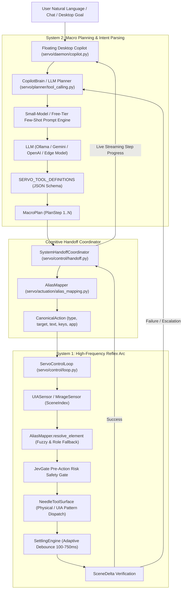

# SERVO ARCHITECTURE SPECIFICATION v3.0.0

**Specification Status:** RATIFIED & ACTIVE  
**Version:** 3.0.0  
**Scope:** System 1 / System 2 Handoff Architecture, Structured Tool Calling, Alias Mapping, and Autonomous Desktop Copilot  
**Predecessors:** [`SERVO_ARCHITECTURE_V1.md`](SERVO_ARCHITECTURE_V1.md) (Immutable Baseline), [`SERVO_ARCHITECTURE_V2.md`](SERVO_ARCHITECTURE_V2.md) (Voice & HUD Protocol)

---

## 1. Executive Summary

Servo v3 introduces the definitive **System 1 / System 2 Cognitive Handoff Architecture**, replacing rigid single-step action heuristics with an autonomous cybernetic servomechanism. System 2 (macro planning and intent parsing) leverages structured tool calling and small-model prompt engineering to decompose open-ended natural language goals into validated execution plans. System 1 (high-frequency reflex arc) executes these setpoints via deterministic alias mapping, boundary sandboxing, Jev safety gates, and verified UI settling.

---

## 2. Architectural Decision Records (ADRs)

### ADR-16: Structured Tool Calling Schema & Macro Plan Decomposition

* **Context:** Previous versions executed user actions in single, rigid passes without formal tool schemas, causing failures on complex compound goals (e.g. *"open notepad, write my name, and click save"*). Small edge models (e.g., Llama-3 8B, Gemini Flash free tier) frequently emit non-conformant JSON when unconstrained.
* **Decision:** Ratified `SERVO_TOOL_DEFINITIONS` adhering to OpenAI/Gemini JSON Schema specifications:
  1. `launch_app(app_name: str)`
  2. `click_element(target: str, button: str = "left")`
  3. `type_text(text: str, target: str = "editor", clear_first: bool = false, press_enter: bool = false)`
  4. `send_hotkey(keys: list[str])`
  5. `wait(duration_seconds: float)`
  6. `close_window(app_name: Optional[str])`
* **Implementation:** `servo/planner/tool_calling.py` implements few-shot prompt construction (`SYSTEM_PROMPT_TEMPLATE`) and robust error-recovering parser (`parse_llm_tool_plan`) supporting markdown code blocks, JSON arrays, and heuristic fallback regex extraction.

---

### ADR-17: Canonical Action & Element Alias Mapping

* **Context:** Users and LLMs refer to desktop interactions using hundreds of synonyms (*"tap"*, *"press"*, *"write"*, *"fill"*, *"enter"*, *"shortcut"*). Similarly, UI elements in Windows (such as modern Windows 11 Notepad) label editors as `"Text editor"`, role `"Document"`, while users refer to `"editor"`, `"input"`, or `"text"`.
* **Decision:** Decoupled action syntax from execution logic using `AliasMapper`:
  * **Action Canonicalization:** Maps 30+ action aliases into 9 `CanonicalActionType` primitives: `CLICK`, `DOUBLE_CLICK`, `RIGHT_CLICK`, `TYPE`, `HOTKEY`, `LAUNCH`, `CLOSE`, `WAIT`, `INSPECT`.
  * **Target Element Resolution:** 6-stage cascading match:
    1. Exact label match (case-insensitive).
    2. Normalized label match (stripping trailing punctuation like `...`, `:`, quotes).
    3. Unique substring match.
    4. Word-boundary regex match.
    5. Role-based fallback (`ROLE_FALLBACK_ALIASES`: `"editor"` -> `("Document", "Edit")`).
    6. Diagnostic reporting for ambiguous or missing targets.
* **Implementation:** [`servo/actuation/alias_mapping.py`](file:///C:/Projects/servo/servo/actuation/alias_mapping.py).

---

### ADR-18: Closed-Loop System 1 / System 2 Handoff Architecture

* **Context:** System 2 operates on symbolic goals at ~1 Hz (macro level), while System 1 operates on deterministic physical and COM events at 50–100 Hz (micro level). Without an explicit coordinator, failure handling between planning and reflex execution creates race conditions or dropped context.
* **Decision:** Introduced `SystemHandoffCoordinator` as the cognitive mediator:
  1. **Progressive Step Dispatch:** Iterates through `MacroPlan.steps`, translating each into a `CanonicalAction`.
  2. **Window Lifecycle Tracking:** Ensures target windows are launched, verified, and activated in the foreground (`SetForegroundWindow`) before keystrokes or mouse clicks are dispatched.
  3. **Event Streaming:** Dispatches callbacks (`on_plan_start`, `on_step_start`, `on_step_progress`, `on_plan_complete`) back to the Copilot UI for live progress rendering.
  4. **Closed-Loop Verification:** Executes each step through `ServoControlLoop` with JevGate risk evaluation and settling engine verification.
* **Implementation:** [`servo/control/handoff.py`](file:///C:/Projects/servo/servo/control/handoff.py).

---

## 3. Mathematical Execution Model

Let a user goal be denoted by $G$. System 2 plans a sequence of discrete macro setpoints:

$$\mathcal{P} = \text{Plan}(G, \mathcal{S}_0) = \{ s_1, s_2, \dots, s_N \}$$

where $\mathcal{S}_0$ is the initial observed `SceneIndex`. Each step $s_i$ maps to a canonical action:

$$a_i = \text{AliasMapper}(s_i) = \langle \tau, \mathbf{t}, \mathbf{x}, \mathbf{k} \rangle$$

System 1 executes $a_i$ through the closed-loop servomechanism:

$$\mathcal{S}_{i} = \text{Settle}(\text{Actuate}(\text{Jev}(\mathcal{S}_{i-1}, a_i)))$$

Verification is governed by the state transition metric:

$$\Delta_i = \text{SceneDelta}(\mathcal{S}_{i-1}, \mathcal{S}_i)$$

Execution of $\mathcal{P}$ succeeds if and only if:

$$\forall i \in \{1, \dots, N\}, \quad \text{Status}(s_i) = \text{SUCCESS} \land \Delta_i.\text{is\_valid}$$

If $\Delta_i$ fails verification, System 1 halts execution immediately and passes $\langle s_i, \mathcal{S}_i \rangle$ back to System 2 for re-planning or user escalation.

---

## 4. Verification & Validation

The v3 architecture is validated through automated test coverage in:
* `tests/test_alias_mapping.py`: Action canonicalization, punctuation cleaning, role-based fallbacks.
* `tests/test_tool_calling.py`: JSON schema validation, few-shot prompt construction, markdown fence parsing.
* `tests/test_handoff.py`: Multi-step plan execution, progressive callback streaming, error halting.
* `tests/test_copilot.py`: Conversational chat, identity memory, macro plan dispatch.
